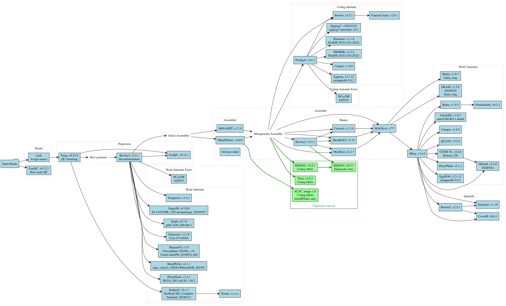

# Overview

This Snakemake pipeline dedicated to Metagenomic data analysis consists out of several modules that
cover a) read-based b) contig-based and c) MAG-based analyses as well as quantification, quality
checks and a report for each module. Naturally, it runs seamlessly
on HPC systems and all required software tools are bundled in docker containers. Further, all required databases are pre-configured and ready to be downloaded from a
central place.

This makes it straight forward and as user-friendly as it can get.

The pipeline is organised in modules, which can run one-by-one. Further, the user can also choose to
run individual tools, giving full flexibility on how to use and run the pipeline. An opt-in module
separates eukaryotic from prokaryotic contigs and bins the eukaryotic ones.

# Installation, Setup and running the pipeline

For a step-by-step tutorial on how to install the pipeline and all pre-compiled databases, please see

Guide to install the pipeline: [Installation](https://github.com/fischuu/Pipeline-Holoruminant-Meta/blob/main/docs/02-Installation.md)

Guide to prepare the configuration files: [Setup](https://github.com/fischuu/Pipeline-Holoruminant-Meta/blob/main/docs/03-Setup.md)

Guide for running the pipeline: [Usage](https://github.com/fischuu/Pipeline-Holoruminant-Meta/blob/main/docs/04-Usage.md)

Information for additional tools: [Extra](https://github.com/fischuu/Pipeline-Holoruminant-Meta/blob/main/docs/05-Extra.md)

For troubleshooting, please visit the collection of most common errors: [Troubleshooting](https://github.com/fischuu/Pipeline-Holoruminant-Meta/blob/main/docs/10-Troubleshooting.md)

# Contributions

List of contributing authors:
...

# Contact
Please use the issue tracker from the GitHub or contact one of the contributors, if you'd prefer personal contact.

## References

Read preprocessing and quality control:
- [`fastp`](https://github.com/OpenGene/fastp)
- [`bowtie2`](https://github.com/BenLangmead/bowtie2)
- [`samtools`](https://github.com/samtools/samtools)
- [`FastQC`](https://github.com/s-andrews/FastQC)
- [`multiqc`](https://github.com/ewels/MultiQC)

Read-based annotation and profiling:
- [`kraken2`](https://github.com/DerrickWood/kraken2)
- [`SingleM`](https://github.com/wwood/singlem)
- [`Nonpareil`](https://github.com/lmrodriguezr/nonpareil)
- [`HUMAnN`](https://github.com/biobakery/humann)
- [`MetaPhlAn`](https://github.com/biobakery/MetaPhlAn)
- [`phyloFlash`](https://github.com/HRGV/phyloFlash)
- [`Sylph`](https://github.com/bluenote-1577/sylph)
- [`Krona`](https://github.com/marbl/Krona)
- [`DIAMOND`](https://github.com/bbuchfink/diamond)
- [`NCyc`](https://github.com/qichao1984/NCyc)

Assembly and binning:
- [`MEGAHIT`](https://github.com/voutcn/megahit)
- [`SPAdes`](https://github.com/ablab/spades) (metaSPAdes)
- [`Prodigal`](https://github.com/hyattpd/Prodigal)
- [`HMMER`](https://github.com/EddyRivasLab/hmmer)
- [`CONCOCT`](https://github.com/BinPro/CONCOCT)
- [`MaxBin2`](http://downloads.jbei.org/data/microbial_communities/MaxBin/MaxBin.html)
- [`MetaBat2`](https://bitbucket.org/berkeleylab/metabat)
- [`MAGScoT`](https://github.com/ikmb/MAGScoT)
- [`dRep`](https://github.com/MrOlm/drep)

MAG and contig annotation:
- [`QUAST`](https://github.com/ablab/quast)
- [`CheckM2`](https://github.com/chklovski/CheckM2)
- [`GTDB-TK`](https://github.com/Ecogenomics/GTDBTk)
- [`DRAM`](https://github.com/WrightonLabCSU/DRAM)
- [`CAMPER`](https://github.com/WrightonLabCSU/CAMPER)
- [`eggNOG-mapper`](https://github.com/eggnogdb/eggnog-mapper)
- [`Bakta`](https://github.com/oschwengers/bakta)
- [`PhyloPhlAn`](https://github.com/biobakery/phylophlan)
- [`Proteinortho`](https://gitlab.com/paulklemm_PhD/proteinortho)

Quantification:
- [`CoverM`](https://github.com/wwood/CoverM)
- [`Subread/featureCounts`](https://sourceforge.net/projects/subread/)

Eukaryotic contigs (opt-in):
- [`Tiara`](https://github.com/ibe-uw/tiara)
- [`4CAC`](https://github.com/Shamir-Lab/4CAC)
- [`REMAG`](https://github.com/danielzmbp/remag)

# Provenance and acknowledgements

This pipeline did not start from scratch. Its development for the Holoruminant project began in 2024
from a fork of [`mg_assembly`](https://github.com/3d-omics/mg_assembly), a Snakemake workflow for
genome-resolved metagenomics from the 3D'omics project, written mainly by Jorge Langa with
contributions from Raphael Eisenhofer and Amalia Toffano. We gratefully acknowledge their work.

- **The fork.** We forked `mg_assembly` at commit
  [`ae01c0d`](https://github.com/3d-omics/mg_assembly/commit/ae01c0d) (January 2024). That fork, with
  its full commit history, is still available at
  [`fischuu/holoruminant_mg_pipe`](https://github.com/fischuu/holoruminant_mg_pipe). This repository
  was started separately in May 2024, so its own history does not show the original authors' commits.
- **Versions up to 0.4.63** (branch [`old`](https://github.com/fischuu/Snakebite-Holoruminant-MetaG/tree/old))
  contain code taken directly from `mg_assembly`.
- **The re-implementation.** Between August and November 2026 (starting with commit
  [`d3e207f`](https://github.com/fischuu/Snakebite-Holoruminant-MetaG/commit/d3e207f)) we re-implemented
  that code. This was not a clean-room rewrite: it was done by a developer who knew the earlier code,
  with AI assistance (Claude Code). The overall flow of the pipeline and the choice and order of tools
  for assembly, binning and dereplication still follow the design of `mg_assembly`, and some rule names,
  file names, result paths, the contig id format and individual lines remain the same or similar.
- **Shared with `mg_quant`.** The module layout, the rule naming scheme and some helper code are shared
  with [`mg_quant`](https://github.com/3d-omics/mg_quant), another 3D'omics workflow published under
  the MIT licence. Its notice is reproduced in [THIRD_PARTY_NOTICES.md](THIRD_PARTY_NOTICES.md).
- **Added since the fork.** metaSPAdes; the read-based tools HUMAnN, MetaPhlAn, phyloFlash, Sylph, Krona,
  DIAMOND and NCyc; the contig annotation module; MAG annotation with Bakta, CAMPER, eggNOG-mapper,
  PhyloPhlAn and Proteinortho; the eukaryote module; per-rule resource escalation; and the PDF reports.

Naming these projects does not imply that their authors have reviewed or endorsed this pipeline. If
this pipeline is useful to you, please also credit `mg_assembly`.
