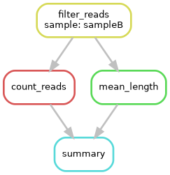
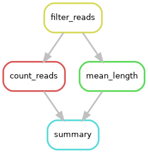

# Chaining rules {#sec-chaining}

So far we have had one rule. A workflow gets its power from connecting rules, and in Snakemake you don't connect them
explicitly: **a rule depends on another rule when its input matches the other rule's output.** That's all. The example is
in `book/examples/snakemake/03_chaining/`.

## Four rules

This workflow filters out short reads, then computes two statistics, and finally writes them on one line:

```python
rule filter_reads:
    """Keep the reads of at least 50 bases"""
    input:
        "data/{sample}_R1.fastq.gz",
    output:
        "results/filtered/{sample}.fastq.gz",
    shell:
        """
        zcat {input} \
            | paste - - - - \
            | awk -F '\\t' 'length($2) >= 50' \
            | tr '\\t' '\\n' \
            | gzip > {output}
        """


rule count_reads:
    input:
        "results/filtered/{sample}.fastq.gz",
    output:
        "results/counts/{sample}.txt",
    shell:
        "zcat {input} | wc -l | awk '{{print $1 / 4}}' > {output}"


rule mean_length:
    input:
        "results/filtered/{sample}.fastq.gz",
    output:
        "results/lengths/{sample}.txt",
    shell:
        """
        zcat {input} \
            | awk 'NR % 4 == 2 {{ total += length($0); n++ }} END {{ print total / n }}' \
            > {output}
        """


rule summary:
    input:
        reads="results/counts/{sample}.txt",
        length="results/lengths/{sample}.txt",
    output:
        "results/summary/{sample}.tsv",
    shell:
        """
        printf '%s\\t%s\\t%s\\n' {wildcards.sample} "$(cat {input.reads})" "$(cat {input.length})" \
            > {output}
        """
```

There are several new things here, so let us go through them.

### A docstring

The text in triple quotes right after the rule name is a short description. It shows up in `snakemake --list-rules`, and
all rules of this pipeline have one.

### Commands over several lines

Triple quotes also let a command run over several lines. Each line is a command of its own, and a backslash at the end of a
line continues the command on the next one. In a normal Python string, a backslash is a special character, which is why
tabs and newlines are written as `\\t` and `\\n`: the doubled backslash reaches the shell as a single one.

The filter uses a well-known trick: `paste - - - -` joins each four lines of FASTQ into one line with tabs in between, `awk`
can then test the length of column 2, and `tr` turns the tabs back into newlines.

### Named inputs

In `summary`, the inputs have names, and the command uses `{input.reads}` and `{input.length}`. Named inputs make a command
easier to read, and let you use the files in any order. The same works for `output:`, and most rules in this pipeline use
names when there are several files.

Choose names with care. Our first version used `count=` here, and Snakemake refused it:

```text
$ snakemake -s Snakefile.reserved --dry-run results/summary/sampleA.tsv
AttributeError in file "/scratch/project_demo/examples/03_chaining/Snakefile.reserved", line 1:
invalid name for input, output, wildcard, params or log: count is reserved for internal use
[exit code 1]
```

Inputs behave like Python lists, and a Python list has a method called `count`, as well as `index` and others. That name is
already taken.

## What Snakemake plans

Ask for one summary and look at the plan:

```text
$ snakemake --cores 1 --dry-run results/summary/sampleA.tsv
host: localhost
Building DAG of jobs...
Job stats:
job             count
------------  -------
count_reads         1
filter_reads        1
mean_length         1
summary             1
total               4

[date]
rule filter_reads:
    input: data/sampleA_R1.fastq.gz
    output: results/filtered/sampleA.fastq.gz
    jobid: 2
    reason: Missing output files: results/filtered/sampleA.fastq.gz
    wildcards: sample=sampleA
    resources: tmpdir=<TBD>
[...]
```

We named only the last file, and Snakemake found the other three steps on its own. Its reasoning went backwards from the
target, and the wildcard value `sampleA` passed along the chain.

Now run it with two cores:

```text
$ snakemake --cores 2 results/summary/sampleA.tsv
[...]
Select jobs to execute...
Execute 1 jobs...
[...]
localrule filter_reads:
[...]
1 of 4 steps (25%) done
Select jobs to execute...
Execute 2 jobs...
[...]
localrule count_reads:
[...]
localrule mean_length:
[...]
Finished jobid: 1 (Rule: count_reads)
2 of 4 steps (50%) done
Finished jobid: 3 (Rule: mean_length)
3 of 4 steps (75%) done
Select jobs to execute...
Execute 1 jobs...
[...]
localrule summary:
[...]
4 of 4 steps (100%) done

$ cat results/summary/sampleA.tsv
sampleA	28	74.2857
```

See what happened in the second round: "Execute 2 jobs". The two statistics don't depend on each other, so Snakemake ran them
at the same time. You didn't have to say this anywhere. It follows from the DAG.

## Seeing the DAG

`--dag` prints the graph in the language of a drawing program called Graphviz. You then pipe it to `dot` to make an image:

```text
$ snakemake results/summary/sampleB.tsv --dag | dot -Tpng > dag.png
```

{width=45%}

`--rulegraph` draws one box per rule rather than per job. On a real project, the DAG can have thousands of boxes, and the rule
graph stays readable:

```text
$ snakemake results/summary/sampleB.tsv --rulegraph | dot -Tpng > rulegraph.png
```

{width=45%}

In a dry run, finished jobs appear with dashed lines in `--dag`, which is a nice way to see how far a project has come. The
pipeline's flowchart in the README is a drawing made by hand from this kind of information.

## Checking on what happened

`--summary` lists the output files with the rule that made them and their status:

```text
$ snakemake --summary results/summary/sampleA.tsv | cut -f 1,3,5
output_file	rule	status
results/summary/sampleA.tsv	summary	ok
results/counts/sampleA.txt	count_reads	ok
results/filtered/sampleA.fastq.gz	filter_reads	ok
results/lengths/sampleA.txt	mean_length	ok
```

Status messages such as "rule implementation changed" appear here too, so this is a quick way to see what Snakemake considers
out of date.

## Why output files matter so much

Since Snakemake only sees files, some consequences follow:

- **The output of one rule must exactly match the input of the next**, character for character. `results/counts/sampleA.txt`
  and `results//counts/sampleA.txt` are different names to Snakemake. This is one reason why this pipeline defines paths once,
  in `folders.smk` (@sec-path-constants).
- **Each output file should come from one rule.** If two rules can make the same file, Snakemake stops with an
  `AmbiguousRuleException`, which @sec-debugging shows.
- **A rule has to create all its declared outputs.** If one is missing after the command finishes, the job counts as failed.
- **Each job should stick to its own output files.** Two jobs of the same rule run at the same time, so they must not write to
  the same temporary file.

## Summary

- Rules connect through file names: an output of one matches an input of another.
- Snakemake works out the order and runs independent jobs in parallel.
- `--dag` and `--rulegraph` draw the plan, and `--summary` shows the state of the results.

We still ask for files one at a time. The next chapter introduces the rule at the top of every real Snakefile.
